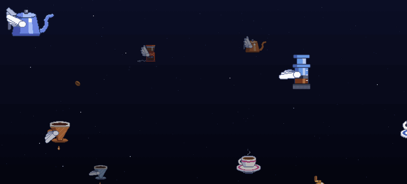

# Night Kettles

A coffee-themed screen saver for macOS, in the spirit of the flying-appliance
savers of the early nineties. Pour-over kettles, cone drippers, plunger
brewers and coffee grinders flap across a night sky, with cups riding their
saucers and beans tumbling alongside.



To watch it live in a browser, open `preview/index.html`. It is a single
self-contained file and runs offline.

## Build and install

You need a Mac running macOS 11 or later with the Xcode Command Line Tools
(`xcode-select --install`). Xcode itself is not required.

```sh
git clone https://github.com/idosela/night-kettles.git
cd night-kettles
./build.sh install
```

This compiles a universal `Night Kettles.saver`, signs it for local use, and
copies it into `~/Library/Screen Savers`. Run `./build.sh` without `install`
to build into `build/` only; double-clicking `build/Night Kettles.saver` then
installs it.

## Turn it on

1. Open **System Settings** and go to **Screen Saver** (on macOS 14 and later
   it is under **Wallpaper**, via the **Screen Saver…** button).
2. Scroll to the **Other** group at the bottom of the list and pick
   **Night Kettles**. Click **Show All** if it is not listed.
3. Click **Options…** to adjust it, and **Preview** to see it full screen.

If Night Kettles does not appear, quit and reopen System Settings.

## Options

| Option | What it does |
| --- | --- |
| Flock | How many things are aloft |
| Speed | How fast they fly |
| Roast | Light, Medium, Dark or French: colours the beans and the coffee in the cups |

## Uninstall

Delete `~/Library/Screen Savers/Night Kettles.saver`.

## Changing it

| Path | What it is |
| --- | --- |
| `art/make_sprites.py` | Draws every sprite sheet. Pure Python, no dependencies |
| `saver/NightKettlesView.m` | The saver itself |
| `saver/Resources/` | The generated sprite sheets |
| `preview/index.html` | The browser preview |
| `build.sh` | Builds and installs the saver |

The art is procedural. Edit `art/make_sprites.py` and run
`python3 art/make_sprites.py` to redraw the sheets and refresh the preview.
Adding a colourway is one more line in the relevant list, and `Z` at the top
sets how fine the pixels are (the engines' `FINE` must match it).

The flight model exists twice, in the preview's JavaScript and in the saver's
Objective-C. Change both together.
